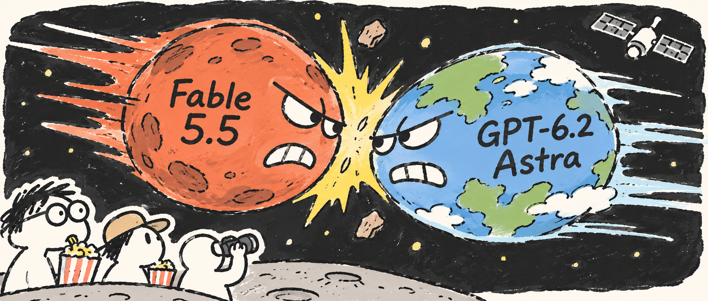
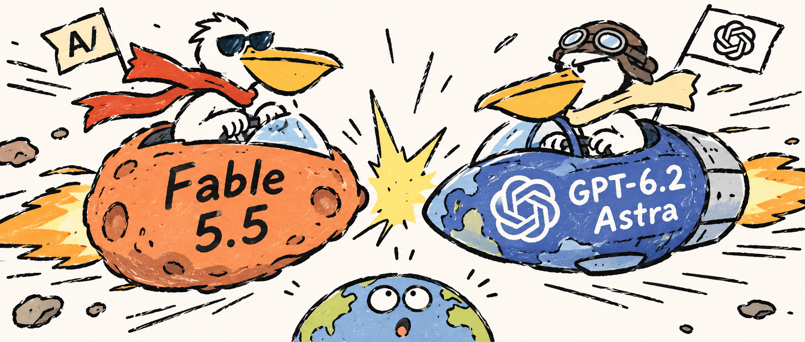
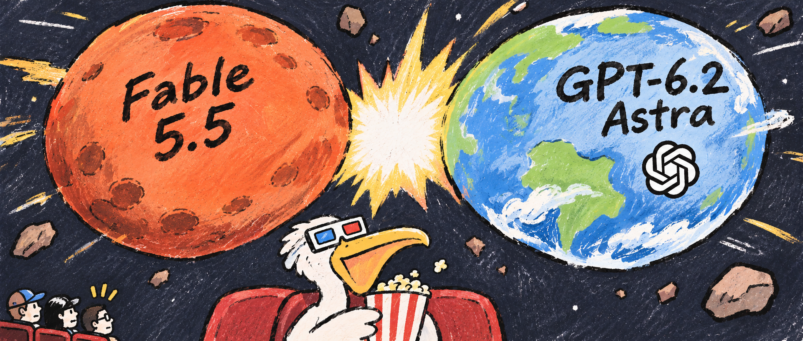

# 手绘公众号封面生成 Skill

根据文章标题和正文生成手绘社论漫画风微信公众号封面，自动加上 **新版边框**，标识位于左上角框线处。最终输出严格 **2.35:1**。

## 使用

将本仓库下载为 `editorial-cover` 文件夹，放入 Codex 的 `~/.codex/skills/`，在新聊天中调用 `$editorial-cover`。

提供标题和正文即可，Skill 会连续完成生图、框内适配与加框，同时保留无边框版。

```text
使用 $editorial-cover 生成封面。
文章标题：……
文章正文：……
```

需要运行环境具备图像生成能力。本仓库提供逐字保留的手绘提示词、调用流程、新版透明边框及合成脚本。

## 边框合成

需要 Python 3 和 Pillow。

```bash
python3 -m venv .venv
source .venv/bin/activate
pip install -r scripts/requirements.txt
python3 scripts/compose_cover.py --input generated.png --output cover-bordered.png --plain-output cover.png
```

脚本默认使用 新版边框，等比铺满框内，裁切超出部分，外侧收紧至约 3 像素保护边。生图时为左上角标识预留背景，避免遮挡主体。

默认输出 1880×800 PNG，保留原图，已有输出文件不会被覆盖。明确需要无边框时使用 `--border none`；接受留白、希望完整保留原图时使用 `--fit contain`。`--focus-x`、`--focus-y` 控制裁切中心，取值 0 到 1。

## 文件

- `SKILL.md`：Skill 调用说明。
- `references/`：手绘风原始 Word、逐字提取的提示词和校验值。
- `assets/borders/`：唯一的新版透明边框。
- `scripts/`：图片适配与边框叠加脚本。
- `agents/`：Skill 显示信息。
- `tests/`：合成行为验证。
- `gallery/`：手绘风作品展示。

## 手绘风作品展示


### AI 科普动画工作室


### AI星球正面碰撞，观众吃爆米花



### Fable与GPT太空对决



### WorkBuddy科学视频工坊


### 国模一哥争夺战


### 星际碰撞与爆米花观众



### 深度对决：锦鲤池畔胜负局


